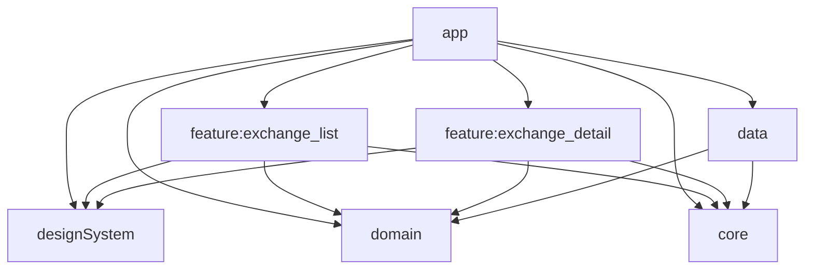

# ✅ Checklist de Melhorias - CryptoExchangesApp

> **Quick Reference** - Use este guia para implementar melhorias priorizadas

---

## 🔴 CRÍTICO - Fazer Primeiro (1-2 semanas)

### 1. Aumentar Cobertura de Testes
**Status:** ⚠️ 40% → Meta: 70%+

- [ ] `ExchangeDetailViewModelTest.kt` - testar todos os estados
- [ ] `ExchangeMapperTest.kt` - validar conversão DTO → Domain
- [ ] `ExchangeIconMapperTest.kt` - validar conversão de ícones
- [ ] `ExchangeDetailScreenTest.kt` - UI test da tela de detalhes
- [ ] Testes de integração (Repository + UseCase)
- [ ] Configurar threshold de 70% no Kover (build.gradle.kts)

**Arquivos a criar:**
```
feature/exchange_detail/src/test/java/
  └── ExchangeDetailViewModelTest.kt

data/src/test/java/com/velosobr/data/mapper/
  ├── ExchangeMapperTest.kt
  └── ExchangeIconMapperTest.kt

feature/exchange_detail/src/androidTest/java/
  └── ExchangeDetailScreenTest.kt
```

---

### 2. Adicionar Diagramas de Arquitetura
**Status:** ❌ Não existe

- [ ] Diagrama de módulos no README.md (usar Mermaid)
- [ ] Diagrama de camadas (Clean Architecture)
- [ ] Diagrama de fluxo de dados (UI → ViewModel → UseCase → Repository → API)

**Exemplo Mermaid para adicionar no README:**


---

### 3. Configurar Ferramentas de Qualidade
**Status:** ❌ Não configurado

- [ ] **ktlint** - formatação automática
  ```gradle
  // build.gradle.kts (root)
  plugins {
      id("org.jlleitschuh.gradle.ktlint") version "12.1.0"
  }
  ```

- [ ] **detekt** - análise estática
  ```gradle
  plugins {
      id("io.gitlab.arturbosch.detekt") version "1.23.4"
  }
  ```

- [ ] Adicionar ao CI (.github/workflows/android-ci.yml):
  ```yaml
  - name: Run ktlint
    run: ./gradlew ktlintCheck

  - name: Run detekt
    run: ./gradlew detekt
  ```

- [ ] Integrar com Codecov:
  ```yaml
  - name: Upload coverage to Codecov
    uses: codecov/codecov-action@v3
    with:
      files: ./build/reports/kover/report.xml
  ```

- [ ] Adicionar badges no README:
  ```markdown
  
  
  ```

---

### 4. Features Essenciais de UX
**Status:** ⚠️ Parcial

- [ ] **Pull-to-refresh** em ExchangeListScreen
  ```kotlin
  // Usar PullRefreshIndicator do Material 3
  import androidx.compose.material3.pulltorefresh.PullToRefreshBox
  ```

- [ ] **Busca** com debounce (500ms)
  ```kotlin
  // Adicionar SearchBar no topo da lista
  // Filtrar exchanges localmente primeiro
  // Depois implementar busca server-side
  ```

- [ ] **Filtros** (por volume, nome, ranking)
  ```kotlin
  // Bottom sheet com opções:
  // - Ordenar por: Nome, Volume, Data
  // - Filtrar por: Volume mínimo
  ```

- [ ] **Estado vazio** (EmptyState component)
  ```kotlin
  // designSystem/src/main/java/.../EmptyState.kt
  @Composable
  fun EmptyState(
      message: String,
      icon: ImageVector,
      actionText: String? = null,
      onAction: (() -> Unit)? = null
  )
  ```

- [ ] **Retry** em erros (botão Tentar Novamente)
  ```kotlin
  // Já existe ErrorBox, adicionar callback:
  ErrorBox(
      message = errorMessage,
      onRetry = { viewModel.retry() }
  )
  ```

- [ ] **Loading skeleton** (Shimmer effect)
  ```kotlin
  // designSystem/src/main/java/.../ShimmerLoading.kt
  // Usar Modifier.placeholder() do Material 3
  ```

---

## 🟡 ALTA PRIORIDADE (2-4 semanas)

### 5. Implementar Offline-First com Room
**Status:** ❌ Não existe

**Estrutura a criar:**
```
database/
├── build.gradle.kts
└── src/main/java/com/velosobr/database/
    ├── AppDatabase.kt
    ├── entity/
    │   ├── ExchangeEntity.kt
    │   └── ExchangeIconEntity.kt
    ├── dao/
    │   ├── ExchangeDao.kt
    │   └── ExchangeIconDao.kt
    └── mapper/
        └── EntityMapper.kt
```

**Checklist:**
- [ ] Criar módulo `:database`
- [ ] Adicionar Room dependencies
- [ ] Criar entities com @Entity
- [ ] Criar DAOs com @Dao
- [ ] AppDatabase com @Database
- [ ] Migrations strategy
- [ ] Atualizar ExchangeRepositoryImpl (cache-first)
- [ ] WorkManager para sync em background
- [ ] Testes com in-memory database

---

### 6. Expandir Design System
**Status:** ⚠️ Básico (3 componentes)

**Componentes a adicionar:**
- [ ] `ShimmerLoading.kt` - skeleton loading
- [ ] `SearchBar.kt` - barra de busca
- [ ] `FilterChip.kt` - chips para filtros
- [ ] `EmptyState.kt` - estado vazio
- [ ] `DSDialog.kt` - dialogs padronizados
- [ ] `DSSnackbar.kt` - snackbars
- [ ] `DSTopAppBar.kt` - toolbar customizado

**Dark/Light Theme:**
- [ ] Adicionar `isSystemInDarkTheme()` no AppTheme
- [ ] Definir cores para light mode em DSColor.kt
- [ ] Toggle de theme (salvar em DataStore)
- [ ] Preview de todos os componentes em ambos os temas

**Acessibilidade:**
- [ ] Content descriptions em todas as imagens
- [ ] Semantics properties nos composables
- [ ] Testar com TalkBack
- [ ] Cores com contraste adequado (WCAG AA)

**Showcase Screen:**
- [ ] Criar tela demo com todos os componentes
- [ ] Navegação para /design-system
- [ ] Grid/List de componentes
- [ ] Útil para documentação e testes visuais

---

### 7. Melhorar Documentação
**Status:** ⚠️ Bom, mas incompleto

**README.md:**
- [ ] Corrigir "Hilt" → "Koin" na seção de DI
- [ ] Adicionar exemplo de `local.properties`:
  ```ini
  sdk.dir=/Users/seu-usuario/Library/Android/sdk
  COIN_API_KEY=SUA_CHAVE_AQUI
  ```
- [ ] Screenshots de TODAS as telas (não só GIF)
- [ ] Seção "Como Testar" com comandos:
  ```bash
  ./gradlew test                    # Unit tests
  ./gradlew connectedAndroidTest    # Instrumented tests
  ./gradlew koverHtmlReport         # Coverage report
  ```
- [ ] Tabela de funcionalidades com status:
  | Feature | Status |
  |---------|--------|
  | Listagem | ✅ |
  | Detalhes | ✅ |
  | Busca | ⏳ |
  | Offline | ⏳ |

**Criar CONTRIBUTING.md:**
```markdown
# Contribuindo

## Setup
1. Clone o repositório
2. Configure API key em local.properties
3. Sync do projeto
4. Execute testes: ./gradlew test

## Code Style
- Kotlin style guide oficial do Google
- ktlint para formatação
- detekt para análise estática

## Pull Requests
- Crie branch: feature/nome-da-feature
- Escreva testes
- Garanta 70%+ de cobertura
- Atualize documentação
```

**Criar ADRs (Architecture Decision Records):**
```
docs/adr/
├── 001-clean-architecture.md
├── 002-koin-over-hilt.md
├── 003-jetpack-compose.md
└── 004-modularization-strategy.md
```

---

### 8. Habilitar ProGuard/R8
**Status:** ❌ Desabilitado

**app/build.gradle.kts:**
```kotlin
buildTypes {
    release {
        isMinifyEnabled = true        // ← Mudar para true
        isShrinkResources = true      // ← Adicionar
        proguardFiles(
            getDefaultProguardFile("proguard-android-optimize.txt"),
            "proguard-rules.pro"
        )
    }
}
```

**app/proguard-rules.pro:**
```proguard
# Retrofit
-keepattributes Signature, InnerClasses, EnclosingMethod
-keepattributes RuntimeVisibleAnnotations, RuntimeVisibleParameterAnnotations
-keepclassmembers,allowshrinking,allowobfuscation interface * {
    @retrofit2.http.* <methods>;
}

# Moshi
-keepclasseswithmembers class * {
    @com.squareup.moshi.* <methods>;
}
-keep @com.squareup.moshi.JsonQualifier @interface *

# Coroutines
-keepnames class kotlinx.coroutines.internal.MainDispatcherFactory {}
-keepnames class kotlinx.coroutines.CoroutineExceptionHandler {}

# Models (manter nomes para debugging)
-keep class com.velosobr.domain.model.** { *; }
-keep class com.velosobr.data.remote.dto.** { *; }
```

**Checklist:**
- [ ] Configurar regras básicas
- [ ] Testar build release localmente
- [ ] Verificar redução de tamanho (antes/depois)
- [ ] Mapfile para deofuscação (uploadar no Play Console)
- [ ] Documentar processo no README

---

## 🟢 MÉDIA PRIORIDADE (Opcional)

### 9. Paginação com Paging 3
- [ ] Adicionar `androidx.paging:paging-compose`
- [ ] Criar `ExchangePagingSource`
- [ ] Atualizar ViewModel para usar `Pager`
- [ ] UI com `LazyPagingItems`
- [ ] Loading/Error states por página

### 10. Analytics e Monitoring
- [ ] Firebase Analytics
- [ ] Firebase Crashlytics
- [ ] Eventos customizados:
  - `screen_view`: exchange_list, exchange_detail
  - `exchange_clicked`: {exchange_id}
  - `search_performed`: {query}
  - `filter_applied`: {filter_type}

### 11. CI/CD Avançado
- [ ] Matrix builds (API 26, 30, 35)
- [ ] Testes instrumentados com emulator
- [ ] Deploy automático (Firebase App Distribution)
- [ ] Release notes automático
- [ ] APK signing no CI

---

## 📊 Métricas de Sucesso

### Qualidade de Código
- **Cobertura de testes:** 40% → **70%+** ✅
- **Warnings de build:** ~10 → **0** ✅
- **Lint issues:** Desconhecido → **0** ✅
- **Linhas de código:** 3.5k → ~6k (com testes)

### Funcionalidades
- **Features críticas:** 2/10 → **8/10** ✅
- **UX essencial:** 3/10 → **9/10** ✅
- **Offline support:** ❌ → **✅**

### Documentação
- **README completeness:** 70% → **95%+** ✅
- **Diagramas:** 0 → **3+** ✅
- **Screenshots:** 1 → **5+** ✅
- **Guides:** 0 → **3** (CONTRIBUTING, ADRs, etc.)

### DevOps
- **CI checks:** 1 → **5+** (tests, lint, coverage, build)
- **Automated releases:** ❌ → **✅**
- **Code quality tools:** 0 → **3+**

---

## 🎯 Timeline Sugerido

### Semana 1-2: Fundação
- ✅ Testes críticos (ExchangeDetailViewModel, Mappers, UI)
- ✅ ktlint + detekt
- ✅ Diagramas de arquitetura
- ✅ Melhorias no README

### Semana 3-4: Features UX
- ✅ Pull-to-refresh
- ✅ Busca e filtros
- ✅ Estados de loading/empty/error
- ✅ Design System expandido

### Semana 5-6: Persistência
- ✅ Room database
- ✅ Cache strategy
- ✅ Offline-first
- ✅ WorkManager sync

### Semana 7-8: Polimento
- ✅ ProGuard/R8
- ✅ Paginação
- ✅ Analytics
- ✅ CI/CD completo

---

## 🚀 Quick Wins (Fazer Hoje!)

Estas melhorias levam < 2 horas cada e têm alto impacto:

1. **Corrigir README** (30 min)
   - Hilt → Koin
   - Exemplo de local.properties
   - Badges de codecov

2. **Adicionar ExchangeDetailViewModelTest** (1-2 horas)
   - Copy ExchangeListViewModelTest
   - Adaptar para DetailViewModel
   - +20% de cobertura

3. **Implementar Pull-to-Refresh** (1 hora)
   ```kotlin
   PullToRefreshBox(
       isRefreshing = isRefreshing,
       onRefresh = { viewModel.refresh() }
   ) {
       // ExchangeList content
   }
   ```

4. **Estado Vazio** (1 hora)
   - Criar EmptyState component
   - Mostrar quando lista vazia
   - Icon + message + action

5. **ktlint setup** (30 min)
   - Adicionar plugin
   - Rodar format
   - Commitar

---

## ✅ Quando Está Pronto?

Seu projeto está pronto para portfólio quando:

- [ ] Cobertura de testes ≥ 70%
- [ ] ktlint + detekt passando sem erros
- [ ] README com diagramas e screenshots
- [ ] Pull-to-refresh, busca, filtros funcionando
- [ ] Offline support com Room
- [ ] Design System com 8+ componentes
- [ ] ProGuard habilitado
- [ ] CI com todos os checks passando
- [ ] Sem warnings no build
- [ ] CONTRIBUTING.md presente
- [ ] Código 100% em inglês

**Meta:** 8/10 itens acima ✅ = Projeto pronto para apresentar

---

**Próximo passo:** Escolha 1-2 itens da seção CRÍTICA e comece hoje! 🚀
